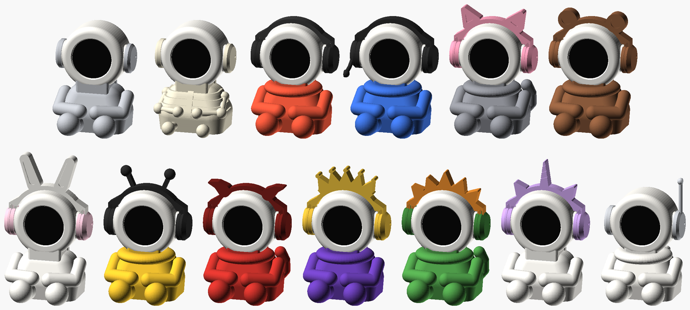
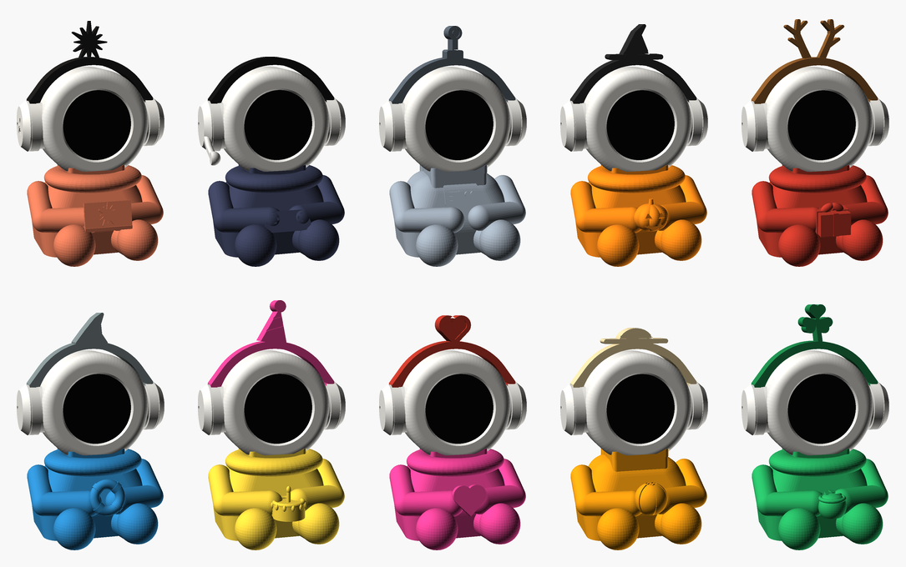

# RoundBot enclosure

The printed body of the desk buddy: one OpenSCAD file, ready‑to‑print STLs
and an assembly guide. Nothing is glued or screwed. A wedge key locks the
head onto the neck, the back cap snaps in, the side pieces twist‑lock into
the head, the band hooks into the cups, the ESP32‑S3 SuperMini slides into
a cradle on the base plate, and the USB cover clicks in from outside against
two stops in the body.

<p align="center">
  
  
</p>

## What's here

| Path | What it is |
|---|---|
| [`round_bot.scad`](round_bot.scad) | The model. Every part comes from this one file: set `part` to a name and export |
| [`stl/core/`](stl/core/) | The five parts every buddy needs: head shell, back cap, neck key, base plate, USB cover |
| [`stl/bodies/`](stl/bodies/) | One body per build (15) |
| [`stl/accessories/`](stl/accessories/) | Bands, ear cups, plugs and pods (26) |
| [`RoundBot_v8_Assembly_Guide.pdf`](RoundBot_v8_Assembly_Guide.pdf) | The assembly guide: parts, what to print for each theme, printing, wiring, assembly, fit tuning |
| [`guide/`](guide/) | The guide's HTML source and the script that prints it to the PDF |
| [`images/`](images/) | Renders and section diagrams used by the guide and the READMEs |

## What to print

A buddy is the core (`head_shell`, `head_cap`, `neck_key`, `base`,
`usb_cover`), one body, and either two `plug`s or a pair of side pieces
with a band. The READMEs in [`stl/bodies/`](stl/bodies/) and
[`stl/accessories/`](stl/accessories/) say which build uses each file, and
the guide's Themes table lists all 22 builds. The core never needs
reprinting to change themes.

The STLs are already in print orientation. Only the bodies need supports
(tree, build plate only). For PLA: 0.2 mm layers, 3 walls, 15% infill, no
brim. One buddy is about 40 to 55 g of filament. The guide's Printing
table has the orientation and notes for every part.

## Changing the model

Open `round_bot.scad` in OpenSCAD, set `part` at the top, render (F6) and
export (F7). Or from the command line, inside this folder:

```sh
openscad -o stl/bodies/body_xmas.stl -D 'part="body_xmas"' round_bot.scad
# macOS app bundle: /Applications/OpenSCAD.app/Contents/MacOS/OpenSCAD

# every STL again (the file name is the part name)
for f in stl/*/*.stl; do openscad -o "$f" -D "part=\"$(basename "$f" .stl)\"" round_bot.scad; done
```

- **Previews**: `part = "assembly"` shows the DJ build in colour,
  `"assembly_claude"` the Claude build, and `"assembly_<theme>"` any of the
  lap themes (`assembly_halloween`, …).
- **Fits**: every clearance and snap is a parameter near the top of the
  file. The guide's Fit tuning table says which one to change for which
  symptom (band too tight, SuperMini loose, USB cover falls out, …).
- **New theme**: add a lap item to `lap_item()`, a topper outline to
  `topper_2d()`, the name to `body_themes` / `band_themes`, and preview
  colours to `theme_col`. That gives `body_<name>`, `band_<name>` and
  `assembly_<name>`. Then export the STLs, add rows to the guide's tables
  (and rebuild the PDF, see [`guide/`](guide/)) and to the theme table in
  the main README. The guide's "Make your own theme" section covers side
  pieces and whole new bodies too.
- **Parameter names**: OpenSCAD lets the last assignment of a name win
  across the whole file without a warning. Check that a new name is not
  already taken (`tab_w`, for one, is the display's header tab).
- **Checking a fit**: preview sections are unreliable for this. Make a
  scratch file that does `include <round_bot.scad>` and then sets
  `part = "none";`, and draw exact 2D cuts of the parts with
  `projection(cut = true)`, one colour per part. `placed = true` exports a
  part in its assembled position instead of its print orientation.

The display is the 1.28" GC9A01 module described in [`../docs/`](../docs/).
