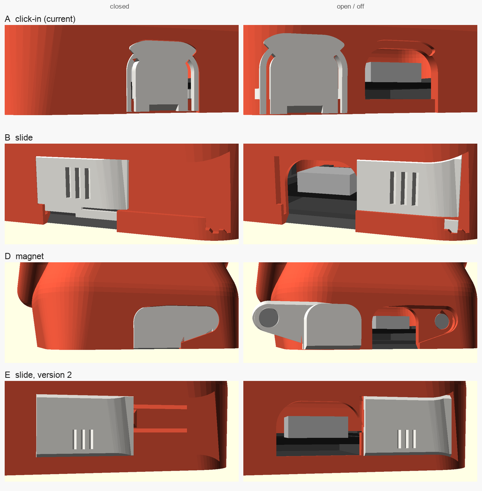

# USB cover variants

Ways to cover the USB-C notch in the back of the body, to print and compare:
- **A** is the cover in `round_bot.scad` today.
- **B** and **D** were each designed by a separate agent after researching that kind of
  cover. A third agent's hinged flap (C) stopped before it produced anything.
- The first print round's feedback: the slider was too hard to move, the clip did not work
  and the cover part was too thick. **E** is a new slide built to fix all three.

Each folder holds its own `.scad`, STLs, pictures and a README with tuning and risks. Each
`.scad` includes `../../round_bot.scad` and replaces only the USB cover, the notch cut and
the `usb_body_extra()` hook.

## Try them

Each folder has `stl/usb_test.stl`: just the back of `body_bare` round the notch, printed
upright in about 15 minutes, no supports. Print the coupon and the cover of a variant first,
and only then a whole body: `stl/body_bare.stl`, or any theme with
`OpenSCAD -o body_cat.stl -D 'part="body_cat"' <variant>.scad`. The base plate is the same for
all of them.

## At a glance

| | A: click-in | B: slide | D: magnet | E: slide, version 2 |
|---|---|---|---|---|
| Folder | [`a_clip`](a_clip/) | [`b_slide`](b_slide/) | [`d_magnet`](d_magnet/) | [`e_slide`](e_slide/) |
| Held by | Two spring strips with teeth behind the wall; a sill and a top recess as stops | A 45-degree rail on top, a lip at the bottom; a spring bump in the shutter clicks at open and closed | A 4 mm magnet pair at one end; the other edge hooks under a 15-degree undercut | A dovetail track; a spring beam in the body's wall clicks into the shutter at open and closed |
| Open with | Nail slot, pull it out | Slide it sideways | Nail slot, swing it out like a door | Slide it sideways |
| Captive (can't get lost) | No | Yes | No | Yes, until you push it out on purpose |
| Extra parts | None | None | 1 x 4x1 mm and 1 x 4x2 mm disc magnet, CA glue | None |
| Cover thickness | 2.4 mm plug | 1.5 mm | 0.8 mm tab, 2.4 mm plug | 1.0 mm |
| Looks | Flush, notch-sized | Flush; the empty track shows beside it | Flush, 23.5 mm wide, one-sided | Flush; the empty track and the spring's slits show beside it |
| Body change | Sill and recess round the notch | A 1.55 mm track across the lower back | A recess, a pin hole and a magnet boss inside the back-left corner | A 1.25 mm dovetail track, a bar under the window, a sprung beam in the wall |
| Thinnest feature | Spring strips 0.8 mm | Spring strip 0.65 mm, wall behind the track 0.85 mm | Tab 0.8 mm, 0.4 mm wall behind the pin's clearance | Shutter 0.6 mm in its channel; wall behind the track 1.15 mm |

Every variant clears the cable's plug, the base plate and the board on their way in. It
also clears every theme's back decoration: hood, cat tail, astro backpack, skeleton spine
and Claude spark. Clearances are checked with exact sections; forces are estimates.
