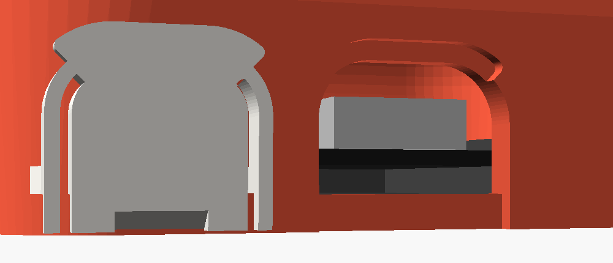

# Variant A: click-in cover (the current design)

The cover in `3d/round_bot.scad` and `3d/stl/core/usb_cover.stl`, kept here as the baseline
the other variants are compared with.

## How it works

You push the cover into the notch from outside until it stops. A slit inside each side
makes that side a spring strip, and a tooth at the bottom of each strip clicks in behind the
wall. Two stops 1 mm behind the outer face hold it flush: a sill across the bottom of the
notch and a recess round the top for a rim on the cover. To take it off, pull it out at the
nail slot in its bottom edge.

## Files

| File | What it is | Print |
|---|---|---|
| `usb_clip.scad` | Includes `round_bot.scad` and adds the test coupon | |
| `stl/usb_test.stl` | The back of `body_bare` round the notch, about 15 minutes | Upright, no supports |

The cover and every body are the regular ones: `3d/stl/core/usb_cover.stl` (outer face
down, no supports) and `3d/stl/bodies/`.

## Tuning (in `round_bot.scad`)

| Problem | Parameter | Default | Change |
|---|---|---|---|
| Stops before it clicks in, falls out, or is too hard to press in | `ucv_bite` | 0.4 mm | Raise to 0.5 / lower to 0.3 |
| Rattles against its stops | `ucv_pre` | 0.1 mm | Raise to 0.15 |
| Too tight or loose in the notch | `ucv_clr` | 0.12 mm | 0.08 to 0.2 |

## Watch for

The spring strips are 0.8 mm wide. They are the thinnest part of any variant and the most
likely to crack after many uses.
