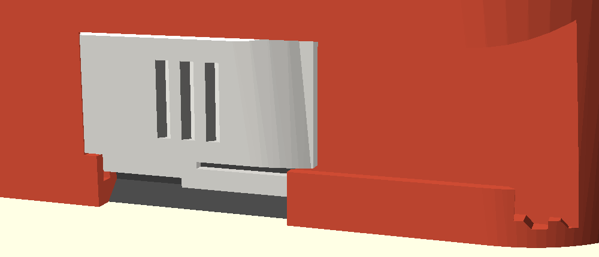
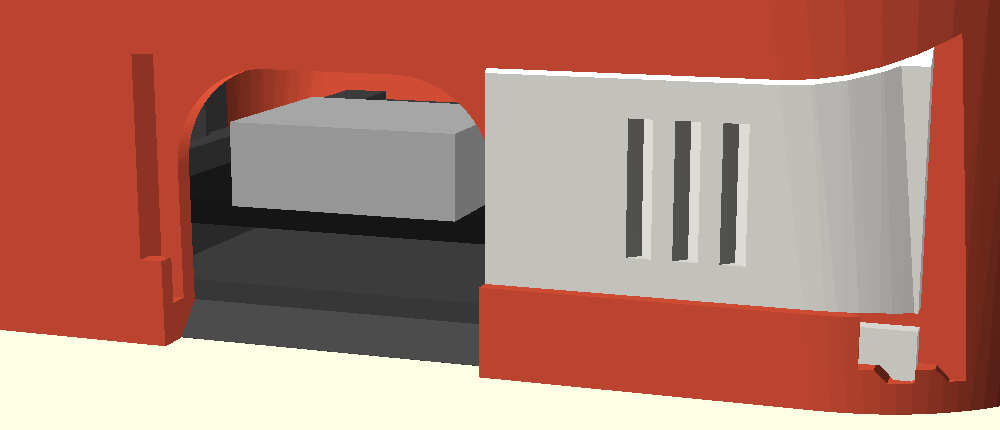
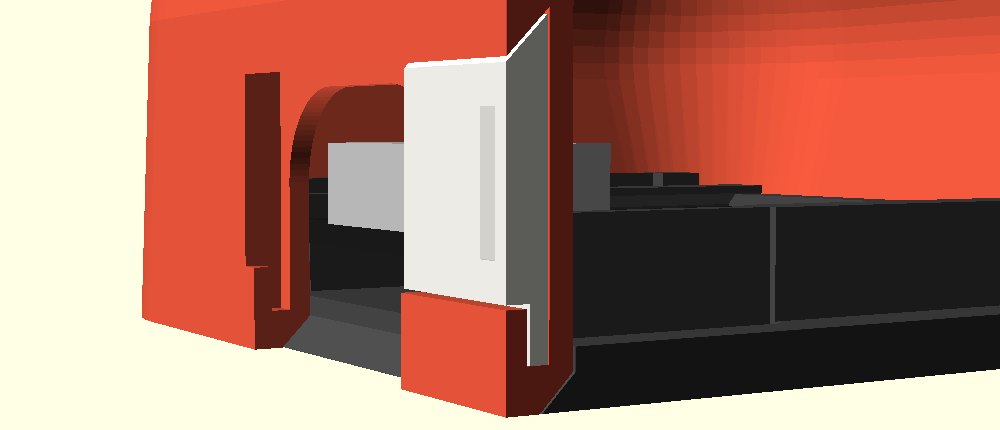

# USB cover B: sliding shutter

A shutter that slides sideways in a shallow track across the lower back.
Directions here are as you look at the robot's back. Slid left, the shutter
covers the USB notch, flush with the back. Slid right, it parks beside the
notch and the whole notch is free for the cable. It clicks at both ends and
cannot fall off.

Closed (hoodie body, from behind and above):

Open: the shutter parks right of the notch, its end following the corner:

Cut through the back at x = -13 with the shutter open: the 45-degree rail
over its top edge, its back layer behind the bottom lip:

Source: `usb_slide.scad` (includes `../../round_bot.scad` and changes only the
USB parts of the body and the cover). In the model's coordinates the shutter
opens towards -x.

## How it works

- **The track.** A recess 1.55 mm deep runs across the bottom of the back,
  from just left of the notch (x = 7.1) to the right-hand back corner (the
  robot's right), where it runs out of the body. Its top edge overhangs the
  shutter at 45 degrees (half a dovetail). Along the bottom a 0.75 mm lip
  stands in front of a narrow slot.
- **The shutter.** A plate 14.65 mm wide, 11.2 mm tall and 1.5 mm thick;
  the part you see is 7.3 mm tall. Its top edge is bevelled to fit under the
  45-degree rail; its back layer hangs down into the slot behind the lip. So
  it cannot be pulled off at the top or the bottom: the only way out is
  along the track.
- **Clicks.** The right half of the back layer is a spring strip, cut free
  by a slit and hidden behind the lip. A bump under its tip rides on the
  slot floor, which presses the shutter up into the rail, so it does not
  rattle. At each end of the travel the bump drops into a dip: click.
- **Captive.** At the open end the dip has a vertical wall on the corner
  side, and the bump a vertical face. Pushing it further right does nothing.
  On the way in the bump drops over that wall, so the shutter goes in from
  the corner once and stays. The closed end is the track's end wall.
- **Why sideways.** There is no room up or down. Above the notch the astro
  backpack starts at z = 11.2, the skeleton's spine at 12 and the Claude
  spark at 13, and the back leans in above 13. Below is the desk. Left of
  the notch the cat's tail starts 1.25 mm past its edge. To the right the
  back is flat for 11.7 mm, enough for the parked shutter except its last
  3 mm, which follow the body's curve round the corner.

## Why this design

What I found (and used):

- Sliding covers on enclosures are held by friction, a spring or small
  detents, and the ports are set back so the cover can slide flush past them
  (patent [US 8025509](https://image-ppubs.uspto.gov/dirsearch-public/print/downloadPdf/8025509),
  [US 8029297](https://image-ppubs.uspto.gov/dirsearch-public/print/downloadPdf/8029297)).
  A printed sliding cap for a printer's USB port uses a tab in grooves with a
  small locking dent at open and closed
  ([MakerWorld 1934429](https://makerworld.com/models/1934429)). Same idea
  here: a recessed track and a dent at each end. (These three I know from
  their search summaries; the pages themselves would not load.)
- Sliding dovetails in PLA want 0.2 to 0.3 mm per side; below 0.2 the layer
  ridges bind. Run the travel along the layer lines, not across them
  ([QIDI: interlocking parts](https://qidi3d.com/blogs/news/how-to-3d-print-interlocking-parts-and-assemblies),
  [Sovol: tolerances](https://www.sovol3d.com/blogs/news/fdm-3d-printing-tolerances-clearances-how-to-design-parts-that-fit)).
  The body prints upright, so the track's layers run along the travel. The
  rail has 0.12 mm drawn in and the spring takes up the rest, so the shutter
  slides loose but sits tight.
- Snap and detent springs: root strain = 1.5 x thickness x deflection /
  length^2; build the spring in the bed plane; a 90-degree return face
  cannot be pulled apart, an angled one can
  ([Fictiv / Core77: snap fits](https://www.fictiv.com/articles/how-to-design-snap-fit-components)).
  The strip (1.25 x 0.65 mm, 7.5 mm free) bends 0.45 mm at 1.5 %
  strain, well under PLA's yield, and lies flat on the bed. It pushes with
  about 1.2 N, so a click takes about 2 N. The open end uses the 90-degree
  face (captive); the dips use 45 degrees (they release).
- The catches on the body face up or are 45-degree overhangs (no support,
  no bridges); the shutter is a flat outline.

## Printed parts

| Part | File | Orientation | Supports |
|---|---|---|---|
| Shutter | `stl/usb_cover.stl` (part `usb_shutter`; the main file's `usb_cover` part would lay it face down, which is wrong for this one) | back face down, as exported | none |
| Body (template) | `stl/body_bare.stl` | upright, as for every body | as for the body; the track needs none |
| Test coupon | `stl/usb_test.stl` | upright | none |

Other themes: `OpenSCAD -o body_<theme>.stl -D 'part="body_<theme>"' usb_slide.scad`.
The base plate and the rest are unchanged.

## Fitting and taking it off

1. Look at the robot's back. Hold the shutter with its grip grooves facing
   you and the end with the slit on your right.
2. Put its left end into the track where the track runs out at the
   right-hand back corner, and slide it left. The top bevel goes under the
   rail, the back layer behind the lip. It clicks once when it is fully in:
   that is the open position.
3. Slide it left to close (click), right to open (click). The base plate can
   be in or out; the shutter does not touch it.

To take it off: open it. Under its right end, at the corner, you can see the
tip of the spring strip. Lift it about 0.5 mm with a fingernail and slide
the shutter out to the right.

## Tuning

| Parameter | Default | What it does |
|---|---|---|
| `sl_clr` | 0.12 | Gap at the 45-degree rail. Raise if it binds, lower if the top wobbles |
| `sl_back` | 0.05 | Gap behind the shutter |
| `sl_lipclr` | 0.1 | Gap between the back layer and the bottom lip |
| `sl_bump` | 0.45 | Bump height and dip depth: how hard it clicks and how firmly it is held at the open end |
| `sl_pre` | 0.07 | How much the strip stays bent when closed |
| `sl_strip_t` | 1.25 | Strip height: more is a stiffer click |
| `sl_strip_l` | 7.5 | Strip length: shorter is a stiffer click (keep 1.5 x t x bump / l^2 under 0.015) |
| `sl_xclr` | 0.15 | Clearance round the bump in the dips |

Changing the strip or bump also moves the bottom of the shutter's face
(`sl_zfb`); the body and shutter follow.

## What to check on the test print

- The shutter slides along the whole track without binding, and the top
  edge does not lift out of the rail.
- Two clear clicks, at closed and at open, and the shutter stays put at each.
- At the open end, a firm push further right does not get it out.
- Lifting the strip tip lets it slide out; it goes back in with one click.
- Closed, it sits flush and does not rattle.
- With the base plate and board in, a USB-C cable plugs in fully with the
  shutter open.

## Known risks

- The spring is small (hidden behind a 0.75 mm lip), so the clicks are
  light. If they are too soft, shorten `sl_strip_l` to 6.5 (stiffer by a
  half, but the strain rises to 2 %, near PLA's limit) or print the shutter
  in PETG.
- PLA creeps: if the shutter sat for months halfway (strip bent), the click
  would weaken. At either end the strip is almost straight.
- The open end relies on a 0.35 mm vertical step. Elephant's foot or a
  rounded bump corner would make it slip; check it on the test print.
- The lower 3.4 mm of the closed notch is covered only by the shutter's back
  layer, set back 0.85 mm, and the bottom 1.5 mm is open to the desk.
- The track leaves the back wall 0.85 mm thick behind it, and the lip is
  0.75 mm. Where the parked shutter follows the corner it thins to 0.8 mm.
- Nothing here has been printed yet. The click force (about 2 N) and the
  strain are beam-formula estimates for PLA.
- When closed, the empty track right of the shutter shows; when open, the
  notch and a 0.85 mm strip of track to its left show.
- The bridge over the top of the notch is now 0.85 mm deep instead of
  2.4 mm (the track takes the outer part).
