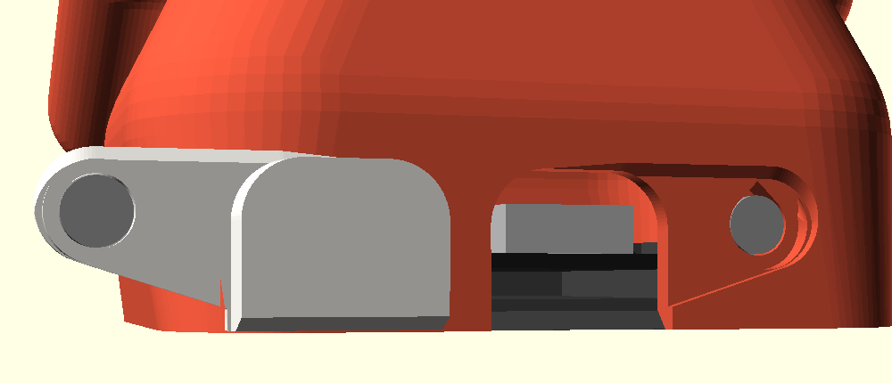
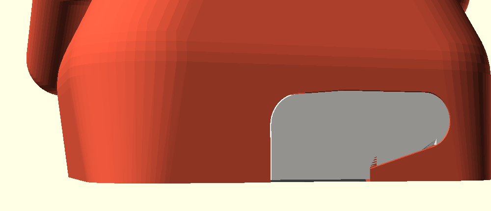

# USB cover D: magnetic cap

  
  

A flat cap, flush with the back, held shut by one pair of 4 mm disc magnets.
No springs, nothing that wears. Everything is in
[`usb_magnet.scad`](usb_magnet.scad), which includes `round_bot.scad` and
replaces its USB cover, the notch cut and the empty `usb_body_extra()` hook.

## How it works

- The cap is D-shaped. Its right part is a plug that fills the notch. Its
  left part is a 0.8 mm tab that lies in a recess in the back wall and ends
  in a round end with a pin on its back. The pin holds a 4 x 1 mm magnet.
- The pin sits in a round hole in the recess floor. At the bottom of that
  hole is a 4 x 2 mm magnet, in a boss on the inside of the back wall. The
  two magnets meet face to face, about 0.3 mm apart.
- The right side of the notch is undercut by 15 degrees, and the plug's
  right side leans the same way. That side hooks in: the cap cannot be
  pulled straight off, or levered off from the right. It can only swing
  open about its right edge, like a small door. The magnet sits at the far
  end of the door, 19.6 mm from the hinge, so it holds with the longest
  lever there is.
- To fit it, put the plug's right edge into the notch first, then swing
  the tab shut. It snaps in. To open it, put a nail in the slot under the
  round end, swing the tab out and lift the cap away. This takes about the
  magnets' pull, about 190 g.
- The pin and the plug take every sideways load. The magnets only pull.

## Why this design

**Space.** I mapped every theme's back decoration around the notch. The
cat's tail starts 2.1 mm right of the notch (x 8.35, z 3.5 to 12). The
astro backpack starts 0.8 mm above it (z 11.15). So a magnet beside the
notch on the right, or above it, would clash on at least one theme. Inside,
the cradle's sprung fingers stand 0.2 mm in front of the wall at |x| 8.4 to
10.4, up to z 6. The wall is 2.4 mm thick, and a hidden magnet pair needs
about 3.8 mm (0.8 skin, two pockets, 0.8 floor), so the body's pocket needs
a boss inside. The one place where the cap, the magnet and the boss fit on
every theme is left of the fingers, at x -13.45, z 7. With only one side
held, a plain magnetic cap would lift on the other side at under 30 g. The
hooked right side fixes that: it turns that side into the hinge.

**Pull.** Vendor figures for N45 discs, measured on thick steel, are
250 g for 4 x 1 and 420 g for 4 x 2
([4 x 1](https://www.supermagnete.fi/eng/disc-magnets-neodymium/disc-magnet-4mm-1mm_S-04-01-N),
[4 x 2](https://www.supermagnete.fi/eng/disc-magnets-neodymium/disc-magnet-4mm-2mm_S-04-02-N)).
3 x 2 is 300 g, 5 x 2 is 680 g (N52) and 6 x 2 is 740 g
([3 x 2](https://www.supermagnete.fi/eng/disc-magnets-neodymium/disc-magnet-3mm-2mm_S-03-02-N),
[5 x 2](https://www.supermagnete.fi/eng/disc-magnets-neodymium/disc-magnet-5mm-2mm_S-05-02-N),
[6 x 2](https://www.supermagnete.fi/eng/disc-magnets-neodymium/disc-magnet-6mm-2mm_S-06-02-N)).
At contact, two equal magnets pull as hard as one magnet on steel. With a
gap, two magnets keep more of their pull than magnet and steel
([FAQ](https://www.supermagnete.fi/eng/faq/What-is-the-difference-between-the-combination-magnet-magnet-and-magnet-iron)).
"Even a small gap of half a millimetre can reduce the adhesive force by
half", and sideways the hold is only 15 to 20 % of the pull
([FAQ](https://supermagnete.de/eng/faq/force)).

So the magnets meet face to face with no plastic between them, and the pin
and the plug take the side loads. I calculated the pull between the two
discs with the magnetic charge model, scaled to the vendor's contact
figures:

| pair | contact | 0.3 mm | 0.5 mm | 1.0 mm |
|---|---|---|---|---|
| 4 x 1 + 4 x 1 | 255 g | 145 g | 110 g | 65 g |
| **4 x 1 + 4 x 2** (this design) | 320 g | **190 g** | 150 g | 95 g |
| 4 x 2 + 4 x 2 (does not fit, see below) | 415 g | 265 g | 215 g | 135 g |

The cap weighs about 0.4 g, so 190 g at the end of the door is a firm snap
that still opens easily with a nail. 4 mm is the largest diameter whose
boss clears the finger while the tab stays under the backpack and on the
flat of the back. The cap's magnet is 1 mm thick because a 2 mm one would
push its pin past the wall's inner face. The pin's hole would then need a
boss too wide to clear the finger.

**Pockets.** Makers use 0.1 to 0.4 mm over the magnet's diameter for a press
fit. A 10 x 3 magnet goes in a 10.3 x 3.1 hole, and very small magnets need
little or none
([Bambu Lab forum](https://forum.bambulab.com/t/dealing-with-magnets-glued-in/96743)).
[Kingroon](https://kingroon.com/blogs/3d-printing-guides/how-to-embed-magnets-into-3d-prints)
adds 0.2 to 0.4 mm, says to test on a small piece and change it by 0.1 mm,
to use a drop of superglue when a magnet falls out, and to mark one face
for polarity. This design uses 0.2 mm on the diameter and 0.1 mm on the
depth.

A print pause would hide the magnets, but the printer head can pull a
magnet out of its hole
([same forum thread](https://forum.bambulab.com/t/dealing-with-magnets-glued-in/96743)).
It would also put plastic between the magnets. So both pockets are open,
for a press fit and a drop of glue.

**The door.** Removable covers that are anchored at one end and latched at
the other are an old pattern for battery doors (for example
[US 5,508,124](https://uspto.report/patent/grant/5508124)). Here the latch
is the magnet.

## What to buy

- 1 x disc magnet **4 x 1 mm**, for the cap.
- 1 x disc magnet **4 x 2 mm**, for the body. Or two 4 x 1 stacked, so three
  4 x 1 in all.
- Both NdFeB (N35 to N52), axially magnetised (poles on the flat faces),
  nickel plated. They are sold everywhere in packs of 50 to 100.
- Thin CA glue (superglue).

## Printed parts

| Part | File | Orientation | Supports |
|---|---|---|---|
| Cap | `stl/usb_cover.stl` | outer face down (as exported) | none |
| Body | `stl/body_bare.stl` (or any `body_<theme>` from `usb_magnet.scad`) | upright | as for the main bodies: tree, build plate only. Keep supports out of the pin's hole and the pocket; the new features need none |
| Test coupon | `stl/usb_test.stl` | upright | none |

Other parts are unchanged: export them from `round_bot.scad` or from this
file (`-D 'part="base"'` and so on). The cap's plug leans 15 degrees, and
the top edge of its tab is bevelled at 45 degrees. The holes in the body
have 45-degree roofs: the pocket is a teardrop, and the roof of the pin's
hole rises going in.

## Fitting the magnets

The magnets must attract. Fit the body's magnet first, then let it set the
way round of the cap's magnet:

1. Put a small drop of thin CA into the pocket, at the bottom of the round
   hole beside the notch. Press the 4 x 2 magnet in with a flat tool until
   it is down, 0.1 mm below the hole's floor. Either way round. Let it
   set.
2. Drop the 4 x 1 magnet into the hole. It jumps onto the body's magnet
   and turns itself the way that attracts. Put a pen dot on its exposed
   face. Slide it off sideways.
3. Put a drop of CA in the cap's pin and press the magnet in **dot first**.
   The dot faces the cap's outside, and the clean face looks at the body.
   It must not stand proud of the pin. Let it set before you fit the cap.
4. Check: held near the hole, the tab is pulled in. If it is pushed away,
   the cap's magnet is the wrong way round.

The rule: the faces that meet are opposite poles. On both magnets, the face
that points out of the robot is the same pole.

## Tuning

All at the top of `usb_magnet.scad`.

| Parameter | Default | Change it when |
|---|---|---|
| `mg_fit` | 0.2 | magnets too tight (cracking): +0.1; loose: -0.1 or glue |
| `mg_deep` | 0.1 | a magnet stands proud and the tab does not sit flush: +0.1 |
| `mg_d`, `mg_t`, `mg_tb` | 4, 1, 2 | other magnets (diameter, cap, body); re-check the sections, the boss is tight |
| `mg_clr` | 0.12 | the cap binds in its recess or the notch: +0.05; gap too wide: -0.03 |
| `mg_pclr` | 0.15 | the pin drags in its hole: +0.05 |
| `mg_gap` | 0.1 | the pin hits the hole's floor before the tab seats: +0.1 |
| `mg_hook` | 0.6 | the right side can be lifted: +0.2; the cap will not swing in: -0.2 |
| `mg_dp` | 0.8 | thickness of the tab = depth of its recess |
| `mg_ns`, `mg_slot` | 0.6, 4 | the nail slot's depth and width |
| `mg_x`, `mg_z` | -13.45, 7 | the magnet's place: do not move it without re-checking the finger, the backpack and the edge of the flat back |

## What to check on the test print

`usb_test.stl` is the back of the body round the notch: 13 mm high, 2 g of PLA.

- The magnets press in with firm thumb pressure and do not fall out.
- With the magnets in, the cap hooks in on the right and swings shut with a
  click. The face is flush with the back all round, with an even hairline
  gap and no step at the tab.
- Pulled straight out, or lifted at the plug's right edge, the cap stays
  in. A nail in the slot under the round end swings it open easily.
- The pin's hole and the pocket are round and clean: no sagging roofs.
- On a full body, with the cap off, a USB-C cable plugs into the board
  through the notch. The base plate still snaps in past the boss (it stands
  0.3 mm from the cradle's left finger).

## How it was checked

All the checks used exact 2D sections (`projection(cut = true)`) of the body,
the cap, the base plate, the board and the magnets in assembled position:

- y = 16.3, 17.0, 18.5 and 19.6
- z = 3, 5.5 and 7
- x = -13.45 (the magnet axis), -10.45, 0 and 6

The boss clears the cradle's finger by 0.31 mm and the plate by 0.89 mm.
The plug clears the receptacle by 0.2 mm. The magnets are 0.3 mm apart.
Every pocket has 0.8 mm round it except the pin's clearance ring noted
below.

z sections of the cap swung open by 0 to 30 degrees about its hooked edge
show no overlap at seven heights. Pulled straight out, it hits the
undercut after 0.2 to 0.5 mm. Lifted at the right about its far end, it
hits after 1 to 2 degrees.

The cap's outline clears the decorations of the real exported `body_cat`
and `body_astro`: 1.7 mm to the tail, 0.46 mm to the backpack. In the
model it clears the skeleton's spine by 1.3 mm and the Claude spark by
3.7 mm. The STLs here, and `body_cat` and `body_astro`, render with no
OpenSCAD warnings, each as one shell.

## Known risks

- **Looks:** the cap is not symmetric. It reaches 10.5 mm left of the notch
  and is 23.5 mm wide. A symmetric cap with a magnet on each side would need
  the cat's tail moved right and the astro backpack moved up.
- **Glue:** each magnet is pulled out of its pocket by the other. If the cap
  magnet's glue fails, it stays stuck on the body's magnet when you open
  the cap.
- **Tight spots:** the boss stands 0.31 mm from the cradle's left finger, and
  the tab's round end reaches to 0.1 mm from where the back starts to
  curve. Behind the pin's 0.15 mm clearance ring the wall is only 0.4 mm
  thick, where the finger leaves no room for the boss.
- **Wires:** the boss takes the inside back-left corner (x -16.8 to -10.2,
  z 2.9 to 11.7, 2.5 mm deep). Route the board's wires clear of it.
- **The hook:** the swing depends on the plug's 15-degree lean printing true.
  Elephant's foot on the cap's first layer makes its face wider: trim it in
  the slicer or raise `mg_clr`.
- **Thin tab:** the tab is 0.8 mm. It is supported by the recess floor when
  pressed, but it would snap if levered hard from its free end.
- **Heat:** NdFeB magnets are rated to 80 C, and PLA softens first.
