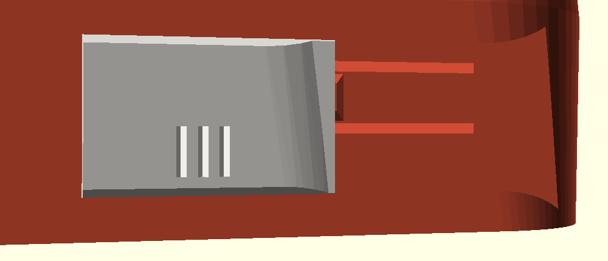
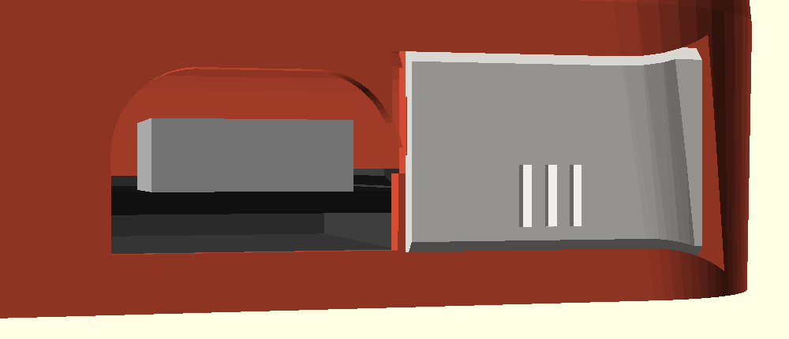
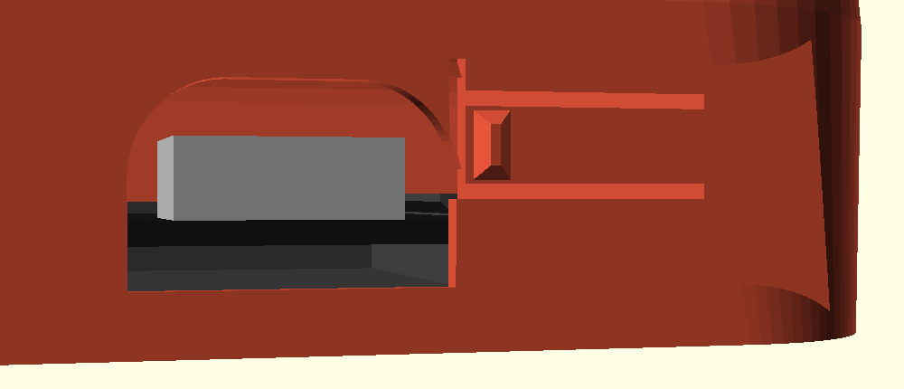

# USB cover E: sliding shutter, version 2

The second try at a sliding cover, after the first print round of the variants: the slide
(B) was too hard to move, the click did not work and the cover was too thick. Seen from the
robot's back, the shutter slides left over the USB window and right to park beside it,
round the back corner. It clicks at both ends.

Closed:

Open: the window is free for the cable:

The track with the shutter out: the spring beam between its two slits, and the bump that
clicks into the shutter:

Source: `usb_slide2.scad` (includes `../../round_bot.scad`; replaces only the USB notch cut,
the cover and the empty `usb_body_extra()` hook).

## What is different from B

| | B | E |
|---|---|---|
| Gap at the flanks | 0.12 mm | 0.3 mm |
| Gap behind the shutter | 0.05 mm | 0.25 mm |
| While sliding | A spring presses the shutter into its rail the whole way | Nothing presses on it: the bump runs in a channel on the shutter's back |
| The spring | 0.65 x 1.25 mm strip in the shutter, hidden behind a lip | 1.15 x 3 mm beam, 10 mm long, in the body's wall |
| Click | 0.45 mm bump, about 2 N | 0.3 mm of travel, about 3 N (estimate) |
| Shutter | 1.5 mm, with a back layer that hangs behind a lip | 1 mm flat plate, nothing under 0.6 mm |
| Notch | Open at the bottom | A window with a 2.4 mm bar under it |

## How it works

- **The track.** A dovetail 1.25 mm deep across the lower back, 45 degrees top and bottom,
  open at the back corner. The wall behind it keeps 1.15 mm. Both flanks print without
  support with the body upright.
- **The window.** The notch now has a bar along its bottom (2.4 mm high at the outer face),
  so the track's lower flank runs under the shutter all the way. The cable's plug starts at
  2.85 mm. Inside, the bar stops 0.5 mm short of the board's USB receptacle, so the base
  plate still slides in from below.
- **The spring is in the body.** Beside the window, on the side where the shutter parks
  (right, seen from behind), the strip of wall behind the track floor is cut free by two
  slits. That makes a beam 10 mm
  long, 3 mm high and 1.15 mm thick, fixed at the far end. The body prints upright, so each
  layer holds the whole beam and it bends the strong way. The slits rise at 45 degrees
  through the wall: no bridges, and you cannot see through them. A bump on the beam's tip
  stands 0.55 mm proud of the track floor.
- **The clicks.** The shutter's back has a 0.4 mm channel where the bump runs, so between
  the ends nothing touches the shutter. Near each end the bump has to climb onto the full
  thickness, which pushes the beam back 0.3 mm:
  - **Closed:** the bump sits just past the shutter's end, on a 35-degree chamfer, and
    pushes the shutter against the end wall. Opening takes about 2 N.
  - **Open:** the bump sits in a pocket near the shutter's other end and still presses
    0.08 mm, so the shutter does not rattle. Leaving towards closed is a 45-degree ramp,
    about 3 N. The pocket's outer wall is 60 degrees, about 7 N, so the shutter stays in
    unless you push it out on purpose.
- **Thin.** The shutter is a 1 mm plate, 14.1 mm wide, flush with the back. The channel
  leaves 0.6 mm. Its end that parks round the corner follows the corner's curve, so it
  tapers.

## Why this design

- Sliding dovetails in PLA want 0.2 to 0.3 mm per side; below 0.2 the layer ridges bind
  ([QIDI](https://qidi3d.com/blogs/news/how-to-3d-print-interlocking-parts-and-assemblies),
  [Snapmaker](https://www.snapmaker.com/blog/3d-printing-tolerances)). B used 0.12 and 0.05.
  E uses 0.3 on the flanks (the upper one is an overhang and prints a little rough) and 0.25
  behind.
- A sliding port cover that stays open by itself, with rails on the cover running in tracks
  on the housing, was the choice over a hinge in a
  [UW Midsun port housing](https://uwmidsun.atlassian.net/wiki/x/dYDqg).
- Cantilever springs: root strain = 1.5 x thickness x deflection / length squared, and
  halve the allowed strain when the beam is printed along Z
  ([Fictiv](https://www.fictiv.com/articles/how-to-design-snap-fit-components),
  [Core77](https://www.core77.com/posts/65318/how-to-design-snap-fit-components)). E's beam
  lies in the layers, not along Z. At the bump it bends 0.3 mm at 0.65 % strain, far under
  PLA's limit, so it should not tire or creep. Pushing about 1.7 N, it gives a click you can
  feel.
- Detents with a ramp both ways release; a steeper wall holds (same sources). The pocket
  uses 45 degrees towards closed and 60 degrees towards the corner.

## Printed parts

| Part | File | Orientation | Supports |
|---|---|---|---|
| Shutter | `stl/usb_cover.stl` | Outer face down (as exported) | None: its top and bottom edges are 45 degrees |
| Body | `stl/body_bare.stl` | Upright, as every body | As for the body; the track, slits and bump need none |
| Test coupon | `stl/usb_test.stl` | Upright | None |

Other themes: `OpenSCAD -o body_cat.stl -D 'part="body_cat"' usb_slide2.scad`. The base
plate and the other parts are unchanged.

Print the test coupon and the shutter first. That takes about 20 minutes.

## Fitting and taking it off

1. Hold the shutter with its grooves facing you and the plain end towards the window.
   Start it into the track where the track runs out at the back corner, and slide it
   towards the window. It clicks once, firmly: that is the open position.
2. Slide it over the window to close it, and back to open. It clicks at both ends.
3. To take it off, open it and push on firmly towards the corner: it clicks out past the
   steeper wall.

## Tuning

| Problem | Parameter | Default | Change |
|---|---|---|---|
| Binds or is hard to slide | `es_clr` | 0.3 | 0.35 to 0.4 |
| Wobbles in the track | `es_clr` | 0.3 | 0.25 |
| Clicks too soft | `es_e` | 0.3 | 0.4 (strain 0.9 %, still fine) |
| Clicks too hard | `es_e` | 0.3 | 0.2 |
| Rattles when open | `es_pre` | 0.08 | 0.12 |
| Opens too easily from closed | `es_lend` | 35 | 45 |
| Comes out of the open end too easily | `es_exit` | 60 | 70 |
| Shutter too thin or thick | `es_t` | 1.0 | 0.9 to 1.2 (the track follows) |

## What to check on the test print

- The shutter slides the whole way with one finger, with no tight spots.
- A clear click closing and opening, and it stays put at each end.
- Closed, it sits flush and does not rattle.
- The spring beam moves freely: press the bump with a fingernail and it springs back.
- On a full body: the base plate still goes in, and a USB-C cable plugs in fully when the
  shutter is open. The window's new bar is 2.4 mm high: check that your cable's plug clears
  it.

## Known risks

- **Untested:** nothing has been printed. The forces assume PLA (E about 3.5 GPa,
  friction 0.3).
- **The corner end:** when open, the shutter's end reaches round the back corner. It tapers
  to follow the curve. At its very end, where it keeps 0.6 mm, it stands up to about
  0.3 mm proud of the corner.
- **Spring in the body:** if the beam ever broke, the body would need reprinting. It runs at
  0.65 % strain, which makes that unlikely.
- **Elephant's foot:** this widens the shutter's outer face. If the shutter rubs at the
  lips, turn on elephant's foot compensation or raise `es_clr`.
- **Looks:** when closed, the empty track and the spring's two slits show beside the
  shutter.
