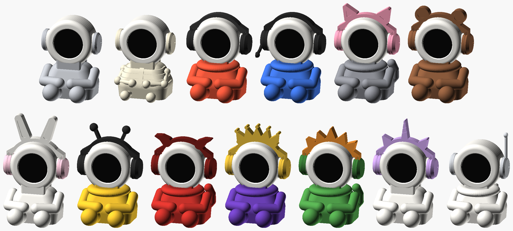
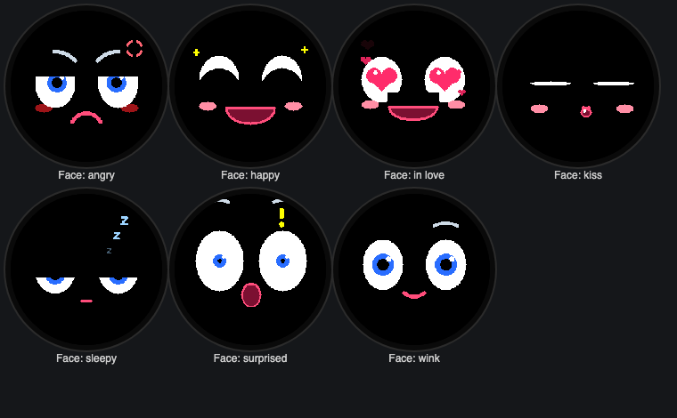
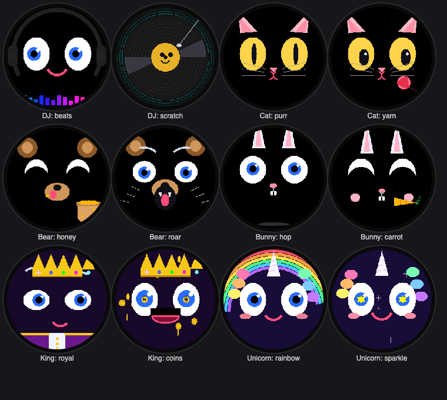
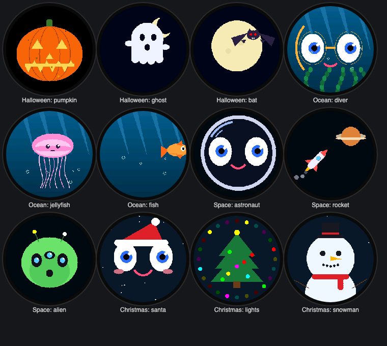
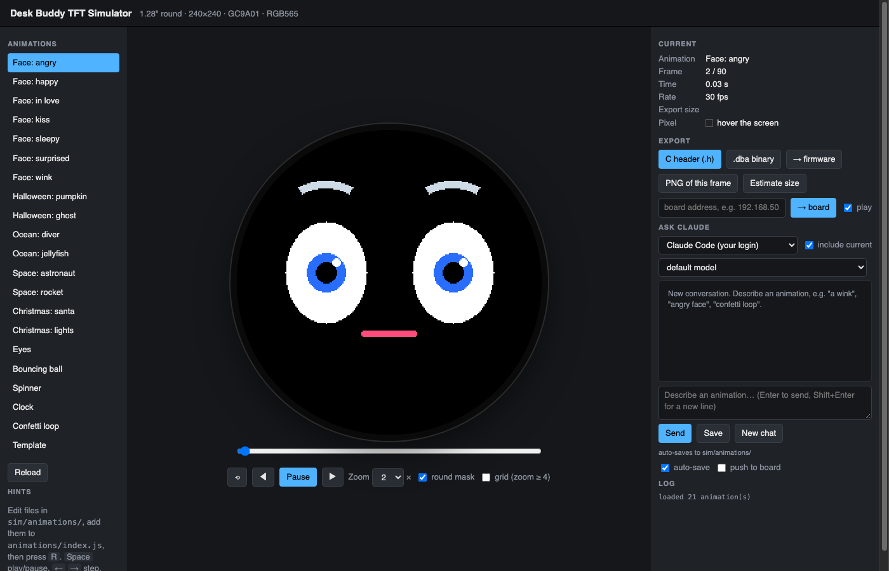
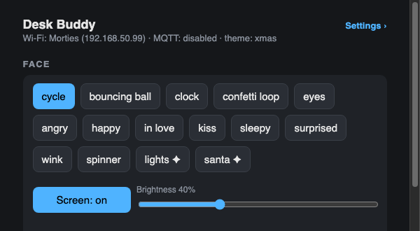
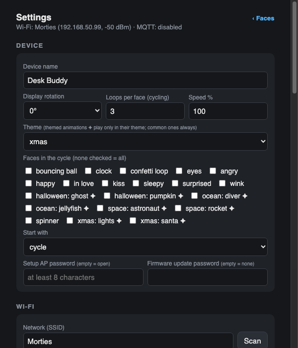
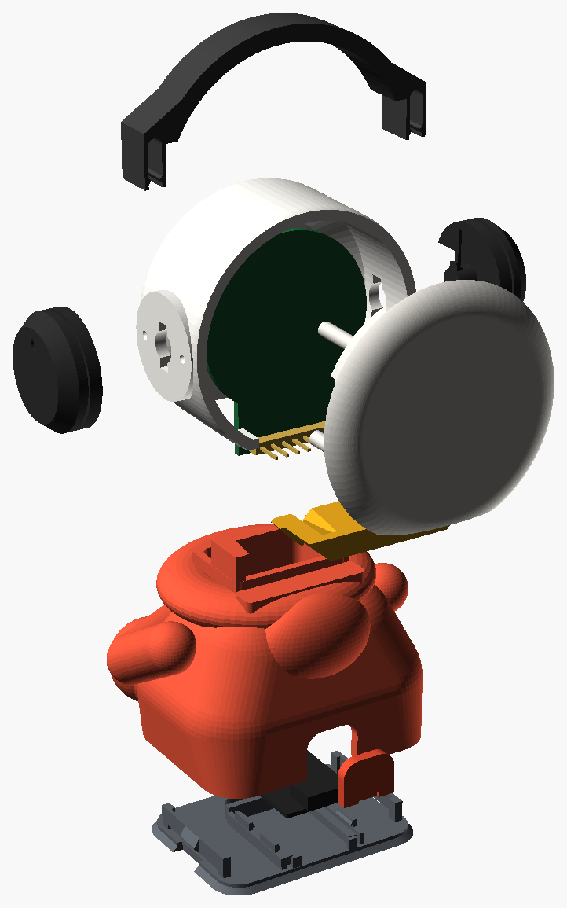
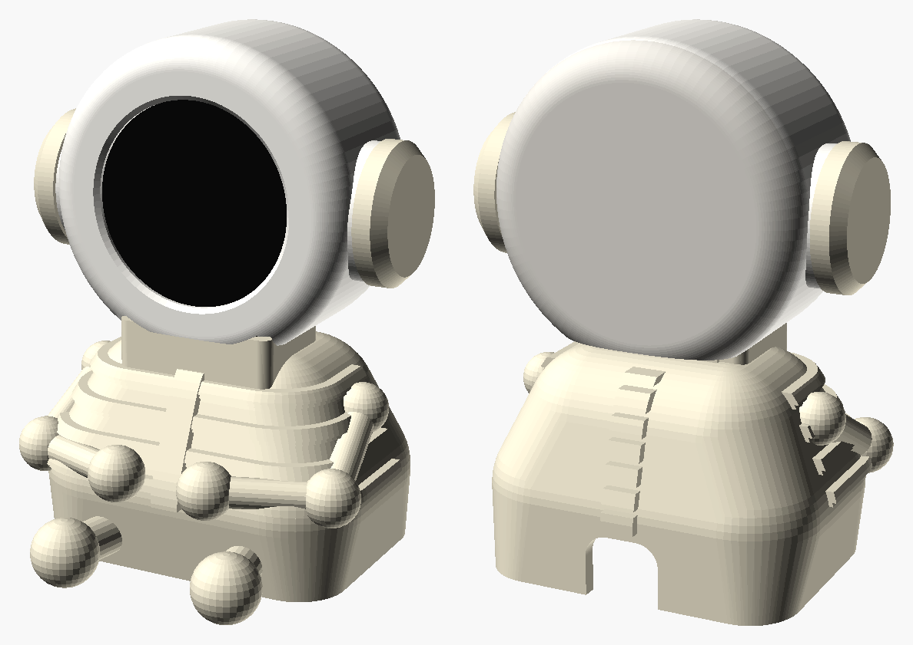

# Desk Buddy

A little desk companion with a round face. The face is a 1.28" round TFT
(240×240, GC9A01) driven by an ESP32‑S3 SuperMini; the animations are drawn
in a browser simulator (or asked from Claude in plain words), pushed to the
buddy over Wi‑Fi, and stored on it. The body is a snap‑together 3D print
with swappable accessories.

<p align="center">
  
</p>

<p align="center">
  
  
</p>
<p align="center">
  
</p>

## What's in the box

| Part | Folder | What it does |
|---|---|---|
| Simulator | [`sim/`](sim/README.md) | Pixel‑exact simulator of the screen in the browser, an animation API, a chat panel that gets Claude to write animations, one‑click push to the buddy |
| Firmware | [`hardware/`](hardware/README.md) | PlatformIO project: setup access point, Wi‑Fi, web pages, MQTT + Home Assistant, animation storage, OTA updates, themes, brightness |
| Enclosure | [`3d/`](3d/) | OpenSCAD model of the RoundBot body and accessories, with an assembly guide |
| Screen docs | [`docs/`](docs/) | The display module's spec sheets and pinout |

## How a face gets from an idea to the desk

1. **Describe it** in the simulator's chat ("a sleepy face that nods off and
   jolts awake") or write it in a few lines of JavaScript against a small
   drawing API. It plays in the simulator immediately.
2. **Push it**: the simulator compresses it and uploads it over Wi‑Fi. The
   buddy shows a loading ring, stores it on its flash file system, and
   starts playing it. No reflash, and it survives reboots and updates.
3. **Pick what plays** from the buddy's web page, Home Assistant, MQTT or the
   serial console: a single face, or cycling through them, with themes.

<p align="center">
  
</p>

The simulator renders into a real 240×240 RGB565 framebuffer with the same
integer rasterisers the microcontroller libraries use, so what you see is
what the panel draws. The right‑hand panel talks to Claude (through your
Claude Code login, or an API key), auto‑saves every working result as a file
and can push it straight to the board.

## The buddy on the network

<p align="center">
  
  
</p>

- First boot: the buddy opens an access point, `DeskBuddy-xxxxxx`, and a
  captive setup page for your Wi‑Fi and MQTT settings.
- On your network: `http://desk-buddy.local/` (name configurable). Faces,
  screen on/off and brightness on the front page; everything else under
  Settings, including firmware update and the list of stored animations.
- MQTT: `deskbuddy/<id>/set` picks a face, with retained state,
  availability, screen, brightness and theme topics. Home Assistant
  discovery exposes a Face select, a Theme select, a Screen switch and a
  Brightness number.
- Themes: animations tagged with a theme only play while that theme is
  selected; the common faces always do. There is a theme per build variant
  (`dj`, `cat`, `bear`, `bunny`, `king`, `unicorn`) and seasonal ones
  (`halloween`, `xmas`, `space`, `ocean`), three animations each for the
  seasons and two per build.

## Hardware

<p align="center">
  
  
</p>

| Display pin | ESP32‑S3 SuperMini |
|---|---|
| VCC | 3V3 |
| GND | GND |
| SCL | GPIO 12 |
| SDA | GPIO 11 |
| DC | GPIO 9 |
| CS | GPIO 10 |
| RST | GPIO 8 |

The body prints without glue or screws: a wedge key locks the head onto the
neck, the back cap snaps in, side pieces twist‑lock on a sprung peg, and the
base plate traps the USB cover. See `3d/RoundBot_v8_Assembly_Guide.pdf`.

## Quick start

```sh
# simulator (http://localhost:8080)
./sim/serve.sh

# firmware: first flash over USB, later updates over Wi-Fi
cd hardware && pio run -t upload          # USB
hardware/ota.sh 192.168.50.99             # OTA

# push every animation to the buddy
sim/test/push_all.sh 192.168.50.99
```

Writing animations: read [`sim/ANIMATIONS.md`](sim/ANIMATIONS.md) (it is
also what Claude is given). Tests: `sim/test/run_tests.sh` checks the
animation format across the JavaScript, Python and C implementations;
`sim/test/smoke.sh` renders every animation in headless Chrome.

## Under the hood

- **Animation format**: per‑frame dirty rectangle, run‑length encoded
  RGB565, the whole stream deflated. A three‑second face is 10–25 KB; the
  buddy holds about 60.
- **Firmware**: a render task on one core, networking on the other, so a
  slow upload or a Wi‑Fi scan never stalls the face. Two 1 MB OTA slots and
  1.9 MB of animation storage on a 4 MB flash.
- **Decoder**: plain C with a single row‑push callback
  (`hardware/lib/dba_player/`), checked on the host against the JavaScript
  and Python encoders.
