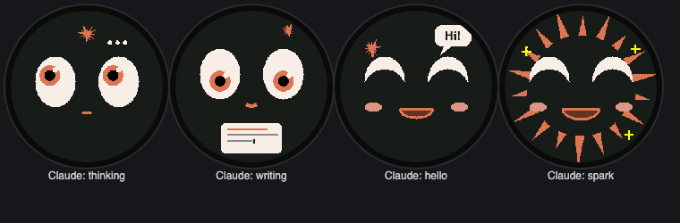
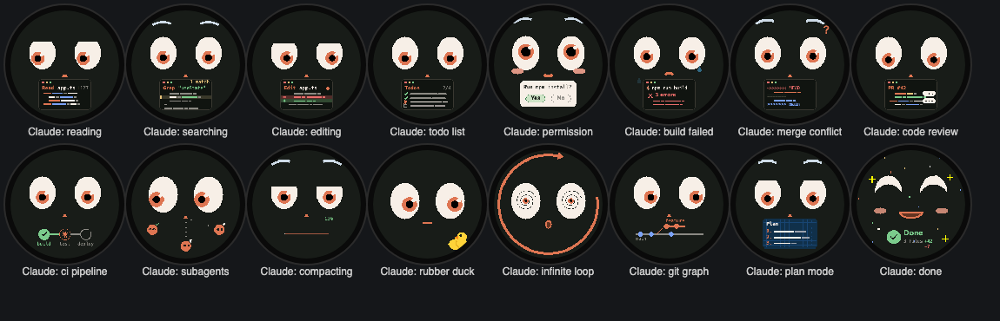
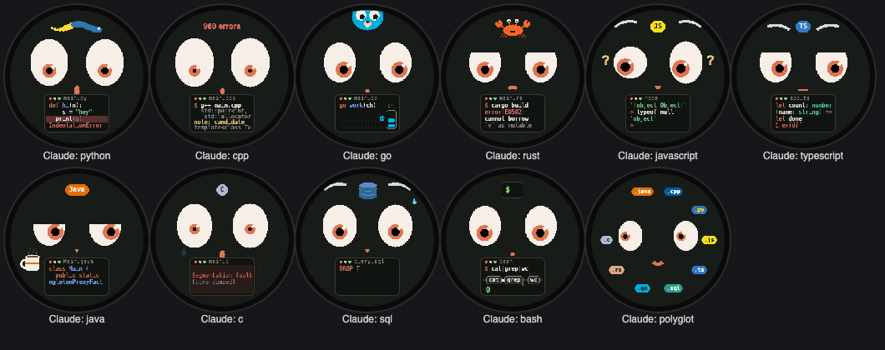
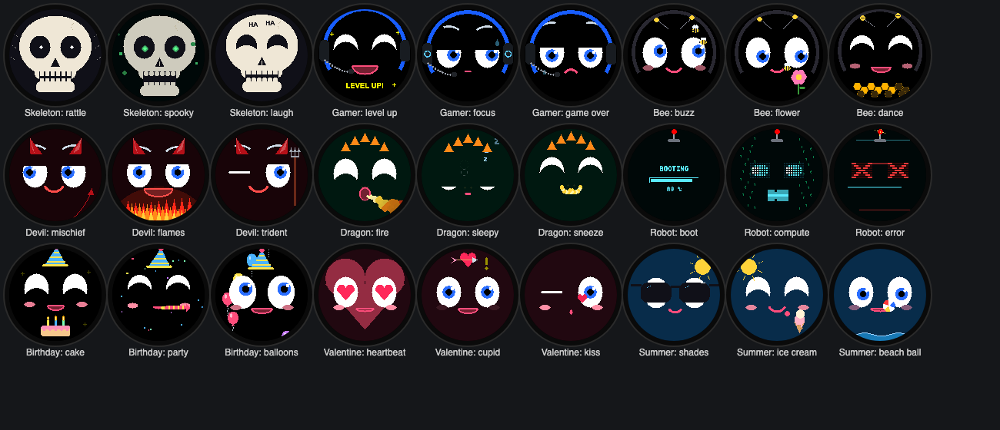
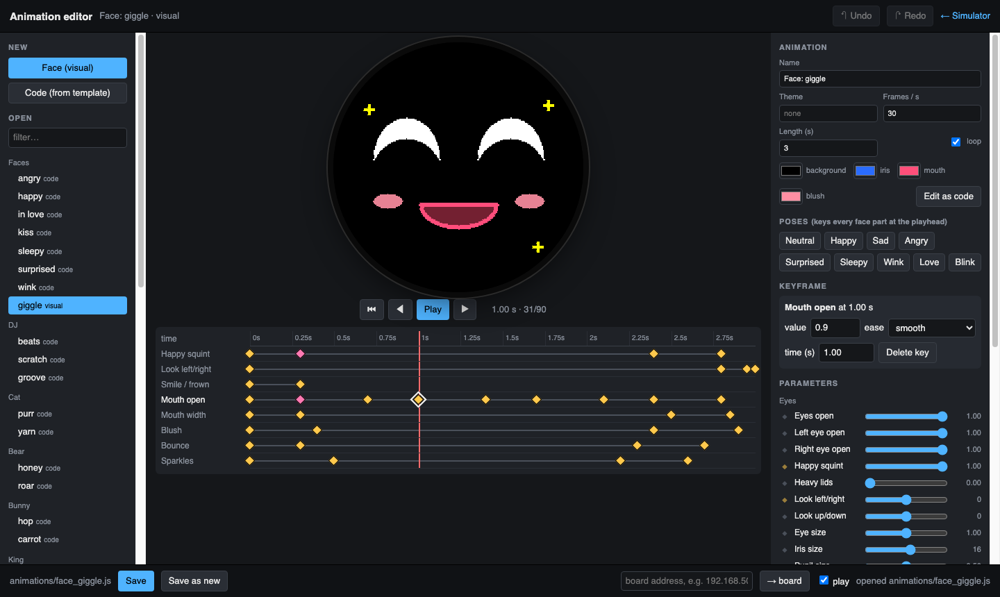

# Desk Buddy

A little desk companion with a round face. The face is a 1.28" round TFT
(240×240, GC9A01) driven by an ESP32‑S3 SuperMini; the animations are drawn
in a browser simulator (or asked from Claude in plain words), pushed to the
buddy over Wi‑Fi, Bluetooth or USB, and stored on it. A phone app, Home
Assistant or the simulator picks what plays, and it can follow along with
Claude Code while you work. The body is a snap‑together 3D print with
swappable accessories.

<p align="center">
  
</p>

<p align="center">
  
  
</p>
<p align="center">
  
</p>
<p align="center">
  
</p>
<p align="center">
  
</p>
<p align="center">
  
</p>
<p align="center">
  
</p>

## What's in the box

| Part | Folder | What it does |
|---|---|---|
| Simulator | [`sim/`](sim/README.md) | Pixel‑exact simulator of the screen in the browser, an animation API, a chat panel that gets Claude to write animations, one‑click push to the buddy |
| Firmware | [`hardware/`](hardware/README.md) | PlatformIO project: Bluetooth LE control with pairing, Wi‑Fi, MQTT + Home Assistant, an HTTP API, animation storage, OTA updates, themes, brightness; a build without Wi‑Fi for more animation storage |
| Phone app | [`app/`](app/README.md) | Flutter app for iOS and Android (also macOS): finds the buddy, pairs, and works as a remote over Bluetooth |
| Claude Code | [`claude_integration/`](claude_integration/README.md) | Hooks that show what Claude Code is doing on the buddy: reading, editing a Python or Rust file, running tests, waiting for your permission, done |
| Enclosure | [`3d/`](3d/) | OpenSCAD model of the RoundBot body and accessories, with an assembly guide |
| Screen docs | [`docs/`](docs/) | The display module's spec sheets and pinout |

## How a face gets from an idea to the desk

1. **Make it**: describe it in the simulator's chat ("a sleepy face that nods
   off and jolts awake"), pose it on a timeline in the animation editor, or
   write it in a few lines of JavaScript against a small drawing API. It
   plays in the simulator immediately.
2. **Push it**: the simulator compresses it and uploads it over Wi‑Fi,
   Bluetooth or USB. The
   buddy shows a loading ring, stores it on its flash file system, and
   starts playing it. No reflash, and it survives reboots and updates.
3. **Pick what plays** over Bluetooth (a phone app or the simulator's remote
   page), Home Assistant, MQTT or the serial console: a single face, or
   cycling through them, with themes.

<p align="center">
  
</p>

<p align="center">
  
</p>

The animation editor (`sim/editor.html`) poses the face with sliders and
keyframes (eyes, lids, brows, mouth, blush, head motion, sparkles, hearts,
tears…), with one‑click expressions and undo, or edits any animation as code
with a live preview. Saving updates the simulator; one click pushes to the
buddy.

The simulator renders into a real 240×240 RGB565 framebuffer with the same
integer rasterisers the microcontroller libraries use, so what you see is
what the panel draws. The right‑hand panel talks to Claude (through your
Claude Code login, or an API key), auto‑saves every working result as a file
and can push it straight to the board.

## Controlling the buddy

- Bluetooth: pair a phone or computer with the 6‑digit code the buddy shows
  on its screen. Then the phone app ([`app/`](app/README.md)), the
  simulator's remote page (`sim/remote.html`) or any BLE UART app controls
  everything, uploads included ([BLE.md](hardware/BLE.md)). The buddy takes
  one connection at a time.
- First boot (Wi‑Fi build): send `wifi <ssid> <password>` over Bluetooth or
  USB serial, or post it to the setup access point `DeskBuddy-xxxxxx`.
- On your network: an HTTP API at `http://desk-buddy.local/` (name
  configurable) for scripts, uploads and firmware updates
  ([API.md](hardware/API.md)). There are no web pages on the device.
- MQTT: `deskbuddy/<id>/set` picks a face, with retained state,
  availability, screen, brightness and theme topics. Home Assistant
  discovery exposes a Face select, a Theme select, a Screen switch and a
  Brightness number.
- Themes: animations tagged with a theme only play while that theme is
  selected; the common faces always do. There is a theme per build variant
  (`dj`, `cat`, `bear`, `bunny`, `king`, `unicorn`, `skeleton`, `gamer`,
  `bee`, `devil`, `dragon`, `robot`) and seasonal or occasion ones
  (`halloween`, `xmas`, `space`, `ocean`, `birthday`, `valentine`,
  `summer`, `stpatricks`), plus a `claude` theme in Claude's coral and
  cream, most of it about coding with Claude Code (36 animations): the CLI
  spinner "Pondering…", reading and grepping files, a diff being edited, a
  todo list ticking off, a permission prompt, a build that breaks and gets
  fixed, a merge conflict, code review, CI going green, subagents fanning
  out, context compacting, rubber‑duck debugging, an infinite loop, a git
  graph, plan mode, `npm test`, `git push`, and "Done". Eleven more are about
  programming languages: Python's indentation, a C++ template error wall, Go
  goroutines racing into a channel, Rust's borrow checker, JavaScript's
  `[] + {}`, TypeScript's red squiggles, Java's long class names (and
  coffee), a C segfault, a very nervous `DROP TABLE`, a bash pipeline, and a
  polyglot ring of file extensions. Every theme has at least three
  animations; the simulator has 110 in all.

## Claude Code on the buddy

With the hooks in [`claude_integration/`](claude_integration/README.md)
installed, the buddy plays the `claude` theme along with your Claude Code
sessions: it reads while Claude reads, types while Claude edits (in the
file's language when that animation is on the buddy: Python, C, C++, Go,
Rust, JavaScript, TypeScript, Java, SQL, bash), watches CI while tests run,
holds up a prompt when Claude needs your permission, and says "Done" when the
turn ends. It needs only Python 3 and the HTTP API of the Wi‑Fi build.

```sh
sim/test/push_all.sh 192.168.50.99 '^Claude'                       # the animations, once
python3 claude_integration/buddy_bridge.py install --host 192.168.50.99
python3 claude_integration/buddy_bridge.py demo                     # every activity, 5 s each
```

The 3D model has a matching Claude build: a coral body with an open laptop
on its lap and the spark on its back, a band with the spark, and ear cups
with the spark engraved (`body_claude`, `band_claude`, `cup_claude_left` /
`cup_claude_right` in `3d/round_bot.scad`; `assembly_claude` previews it).

## Hardware

<p align="center">
  
  
</p>

| Display pin | ESP32‑S3 SuperMini |
|---|---|
| VCC | 3V3 |
| GND | GND |
| SCL | GPIO 12 |
| SDA | GPIO 11 |
| DC | GPIO 9 |
| CS | GPIO 10 |
| RST | GPIO 8 |

The body prints without glue or screws: a wedge key locks the head onto the
neck, the back cap snaps in, side pieces twist‑lock on a sprung peg, and the
base plate traps the USB cover. See `3d/RoundBot_v8_Assembly_Guide.pdf`.

## Quick start

```sh
# simulator (http://localhost:8080)
./sim/serve.sh

# firmware: first flash over USB, later updates over Wi-Fi
cd hardware && pio run -t upload                              # Wi-Fi build, USB
hardware/ota.sh 192.168.50.99                                 # Wi-Fi build, OTA
cd hardware && pio run -e esp32s3_supermini_ble -t upload     # build without Wi-Fi (USB only)

# push every animation to the buddy: an address, or usb / ble
sim/test/push_all.sh 192.168.50.99
sim/test/push_all.sh ble '^Claude'        # only names matching a regex

# phone app (a real phone: Bluetooth does not work in the simulators)
cd app && flutter run
```

Writing animations: read [`sim/ANIMATIONS.md`](sim/ANIMATIONS.md) (it is
also what Claude is given). Tests: `sim/test/run_tests.sh` checks the
animation format across the JavaScript, Python and C implementations;
`sim/test/smoke.sh` renders every animation in headless Chrome. The app has
`flutter analyze && flutter test` (against a fake buddy) and a device test;
the Claude Code bridge has `python3 claude_integration/test_bridge.py`.

## Under the hood

- **Animation format**: the changed rectangles of each frame (several small
  ones when the changes are far apart), run‑length encoded RGB565, the whole
  stream LZMA‑compressed. A three‑second face is 4–12 KB; all of the
  simulator's animations together come to 1.4 MB and fit on the Wi‑Fi build,
  and the build without Wi‑Fi has room for about twice that.
- **Firmware**: a render task on one core, networking on the other, so a
  slow upload or a Wi‑Fi scan never stalls the face. On the 4 MB flash the
  Wi‑Fi build has two 1 MB OTA slots and 1.9 MB of animation storage; the
  build without Wi‑Fi has one 640 KB app slot and 3.3 MB of storage
  ([two builds](hardware/README.md#two-builds)). Bluetooth fits next
  to Wi‑Fi only because of a set of size trims, listed in the firmware
  README.
- **Decoder**: plain C with a single row‑push callback
  (`hardware/lib/dba_player/`), checked on the host against the JavaScript
  and Python encoders.
