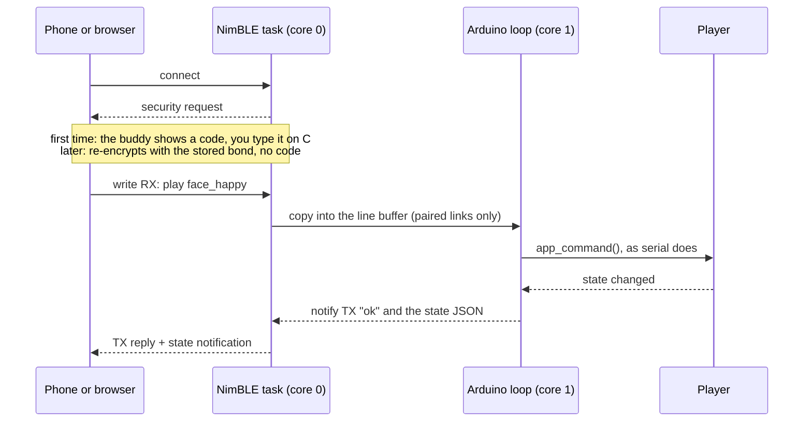

# Bluetooth LE control

A paired phone or computer can do everything over Bluetooth LE that USB
serial can: pick faces, set brightness and theme, change settings (Wi-Fi,
MQTT, name), manage and upload animations, reboot. The buddy advertises under
its device name (default "Desk Buddy"). Only a paired device gets in: the
first connection asks for a 6-digit code that the buddy shows on its screen.

In the Wi-Fi build, Bluetooth is on by default and runs next to Wi-Fi; switch
it with `ble on` / `ble off` (serial or Bluetooth) or `ble=1|0` in
`POST /api/config` ([API.md](API.md)); both reboot. In the build without
Wi-Fi (`pio run -e esp32s3_supermini_ble`) it is always on: it is the only
wireless link. `status` and `GET /api/status` show `off`,
`advertising as 'Desk Buddy', 1 paired`, `connected, not paired` or
`connected, paired`.

## How the connection works

The buddy is a Bluetooth LE peripheral with one service, the Nordic UART
Service (NUS). Clients write text commands to RX and get text replies on TX,
plus a JSON state characteristic. Every connection starts with pairing or,
for a device paired before, with re-encryption.



| Part | UUID | Properties | Carries |
|---|---|---|---|
| Service | `6e400001-b5a3-f393-e0a9-e50e24dcca9e` | | Nordic UART Service |
| RX | `6e400002-b5a3-f393-e0a9-e50e24dcca9e` | write, write without response (paired link) | commands, upload data |
| TX | `6e400003-b5a3-f393-e0a9-e50e24dcca9e` | notify (sent on a paired link only) | replies, as text lines |
| State | `8b3f2a51-6c0d-4e7a-9b14-d2e5f7a90c36` | read (paired link), notify | the state JSON |

- **Advertising.** The service UUID is in the advertisement. The name (the
  device name, first 29 characters) is in the scan response, because one
  packet has no room for both.
- **One connection.** While a client is connected the buddy stops
  advertising, and starts again when it leaves.
- **MTU.** The client negotiates it (255 from a Mac with bleak). Replies are
  split into notifications of MTU − 3 bytes, and the client joins them at the
  newline.

## Pairing and security

Only a paired device can read the state or send commands. Pairing is LE
Secure Connections with passkey entry: the buddy displays a random 6-digit
code and the phone or computer asks you to type it.

1. Connect (remote page, phone app or script). The buddy asks to pair at once.
2. Its screen shows "Bluetooth pairing" and the code in large digits, even if
   the screen was switched off. USB serial prints it too.
3. Type the code into the system's pairing prompt. The face comes back when
   pairing succeeds; a wrong code shows "pairing failed".
4. Both sides store the bond, so later connections are encrypted without a code.

| | Unpaired device | Paired device |
|---|---|---|
| Find the buddy, connect, see the service | yes | yes |
| Read the state characteristic | refused (needs an authenticated link) | yes |
| Send commands or upload data to RX | refused | yes, every command |
| Receive replies and state notifications | never sent | yes |

- **No code, no access.** "Just Works" pairing (what a device without a
  keyboard or screen would get) gives an unauthenticated link: the buddy
  deletes that bond and drops the connection.
- **Secure Connections only.** Pairing uses an ECDH key exchange, so a
  recorded pairing does not reveal the key. Legacy pairing, whose passkey can
  be brute-forced from a recording, is not compiled in. Devices from before
  Bluetooth 4.2 therefore cannot pair.
- **A new code each time.** The code comes from the chip's hardware random
  generator and leaves the screen after 60 seconds or when the client
  disconnects.
- **Up to 3 paired devices.** A fourth pairing replaces the oldest bond.
- **A paired device is trusted fully.** Pairing needs someone at the buddy to
  read the code, the same bar as plugging in USB, so a paired device gets every
  command, including `wifi`, `delete` and `reset`. Forget a phone you lose.
- **Forgetting.** `ble forget` (serial or Bluetooth), `POST /api/ble/forget`,
  or a factory reset (`reset`) deletes every bond. Also remove "Desk Buddy"
  from the phone's Bluetooth list, or it keeps trying the old key and fails.

Checked on the board on 2026-11-12. A client that had not typed the code had
its state read and its `play` command refused, and nothing ran. Once the code
was typed, the command went through. A bonded Mac re-encrypted 0.6 s after
connecting, with no code.

## Commands

A paired device runs the USB serial console's commands. Send one command per
line (ending in `\n` or `\r`), or one per write: a write without a newline
runs after a 150 ms pause. A command is at most 160 characters, and every
reply ends with a newline; a command that prints nothing answers `ok`.

| Command | What it does | Reply |
|---|---|---|
| `play <name>` | Play one animation and stay on it | `ok`, or `no animation named '<name>' (try: list)` |
| `play cycle` or `cycle` | Resume cycling through the faces | `ok` |
| `cycle a,b` or `cycle all` | Set which faces cycle (saved), then cycle | `cycle list 'a,b'` |
| `next` | Skip to the next face | `ok` |
| `screen on` / `screen off` | Display on or off (saved) | `ok` |
| `brightness <10-100>` | Software dimming (saved) | `brightness 60%` |
| `theme <name>` / `theme none` | Select a theme; letters and digits only | `ok` |
| `speed <25-400>` | Playback speed in percent (saved) | `speed 150%` |
| `loops <1-50>` | Loops per face while cycling (saved) | `loops 3` |
| `rotation <0-3>` | Display rotation in steps of 90° (saved) | `rotation 1` |
| `names` | Every animation name on one line | `names bear__honey,bear__roar,…` |
| `state` | The state JSON on one line | `state {"current":…}` |
| `config` | Settings and status as JSON on one line (name, version, speed, loops, rotation, cycle list, start face, storage, paired devices, battery; Wi-Fi and MQTT in the Wi-Fi build) | `config {"name":…}` |
| `start <name>` / `start cycle` | What plays after a reboot (saved) | `start 'face_happy'` |
| `list` | Names with sizes and free space | one line per animation |
| `status` | The status report | animation, name, Wi-Fi, MQTT, Bluetooth, battery, memory |
| `battery` | The battery as JSON on one line ([README](README.md#battery-level-optional)) | `battery {"present":true,"mv":3912,"pct":64,"low":false}` or `battery {"present":false}` |
| `battery cal <mV>` / `battery cal reset` | Correct the reading to a multimeter's (saved) / undo | `battery calibrated: x1.0123, now 3950 mV` |
| `upload <name> <bytes>` | Receive an animation on this link | see Uploading animations |
| `delete <name>` | Delete a stored animation | `deleted` or `not found or built-in` |
| `name <device name>` | Rename (Bluetooth name, mDNS, Home Assistant); reboots | `saved, rebooting` |
| `ble forget` / `ble on` / `ble off` | Forget all bonds / Bluetooth on or off (reboots) | |
| `reboot` / `reset` | Reboot / erase all settings and bonds, then reboot | |
| `wifi <ssid> <password>` | Wi-Fi network; reboots. Quote a name with spaces: `wifi "My Home" secret` | `saved, rebooting` |
| `mqtt <host> [port] [user] [password]`, `prefix <topic>` | MQTT broker and topic prefix; reboot | `saved, rebooting` |
| `ha on` / `ha off` | Home Assistant MQTT discovery (saved) | `home assistant discovery on` |
| `appass <password>`, `ap` | Setup access point password / start it now | |
| `otapass <password>` | Firmware update password; empty removes it | |

The last five rows exist only in the Wi-Fi build; the build without Wi-Fi
answers `<command>: this build has no Wi-Fi`, and refuses `ble off`. Any
unknown command, `help` included, answers with the command list.

## Uploading animations

Animations can be uploaded over Bluetooth (from a paired device) and over USB
serial, with the same protocol; it is the only way into the build without
Wi-Fi. From the simulator, enter `ble` (or `usb`) as the board address next
to **→ board**; from a terminal:

```sh
sim/test/push_all.sh ble                        # every animation (usb: over USB serial)
sim/test/push_all.sh ble '^Face'                # names matching a regex
python3 sim/tools/dba.py push face.dba --host ble --name face_wave --play
```

`ble:<name>` picks a buddy by name and `usb:<port>` a serial port; plain
`usb` finds the Espressif USB port. These go through `sim/serve.py`
(`push_to_board`) and need `bleak` / `pyserial`. On macOS the first
Bluetooth push brings up the pairing prompt.

The protocol, for writing your own client:

```
> upload face_wave 23514            the name (a-z 0-9 _, up to 31) and the exact byte count
< ready 2048                        or: error <reason> (no space, bad name, another upload running)
> (2048 bytes of the .dba file)     raw bytes, DBAL (or DBAZ, DBA1) as the simulator exports them
< ack 2048
> (next 2048 bytes)  ...            wait for each ack before sending the next window
< ack 23514                         after the last byte
< stored face_wave 812 KB free      or: error <reason> (not a valid animation, ...)
```

- On Bluetooth, send the data as writes without response of up to MTU − 3
  bytes; the window keeps the buddy's 4 KB receive buffer from overflowing.
- On USB serial, other log lines are interleaved; pick out the lines that
  start with `ready`, `ack`, `stored` or `error`.
- 10 s without data aborts the upload; so does a Bluetooth disconnect.
- One upload at a time across HTTP, USB and Bluetooth: a second one gets
  `error busy` (HTTP 409).
- An upload with an existing name replaces it, but needs room for the new
  copy first.

## State characteristic

The state characteristic always holds the buddy's current state as about
135 bytes of JSON, and notifies paired clients on every change. The change
can come from Bluetooth, MQTT, the HTTP API, serial or the battery.

```json
{"current":"face_happy","cycling":false,"screen":true,"brightness":60,"theme":"bunny","count":37,"bat":64,"batLow":false}
```

| Field | Meaning |
|---|---|
| `current` | Playing animation, or `cycle` while cycling |
| `cycling` | `true` while the buddy cycles through faces |
| `screen` | Display on or off |
| `brightness` | 10 to 100 (percent) |
| `theme` | Selected theme, `""` for none |
| `count` | Number of stored animations; when it changes, send `names` again |
| `bat` | Battery charge 0 to 100 (percent), `null` without a battery. Firmware before the battery measurement leaves it out: treat that as `null`. Changes notify when they reach 2 %, or 1 % that lasts a minute |
| `batLow` | `true` while the battery is low (15 % and below, until it is back at 20 %); the buddy shows its low battery face then |

The themes are the `<theme>__` prefixes in the `names` list (`xmas__santa`
belongs to `xmas`); a theme's faces play only while it is selected. Cycling
from one face to the next does not notify, because `current` stays `cycle`.
The characteristic also notifies once a client's link is secured.

A notification carries at most MTU − 3 bytes. At the usual MTUs (185 and up)
the JSON fits in one; at a smaller MTU it arrives cut off, and a read of the
characteristic returns the whole value.

In Web Bluetooth, `readValue()` fires the same `characteristicvaluechanged`
event as a notification. A client that reads inside that handler starts a
read loop. The first remote page did this and made 87 reads in 3 seconds,
which made every command take seconds.

## Clients

All of these pair through the operating system's prompt the first time.

**Remote page (`sim/remote.html`).** Run `./sim/serve.sh`, open
http://localhost:8080/remote.html in Chrome or Edge (desktop or Android),
press **Connect** and pick "Desk Buddy". The first time, the page says to type
the code and waits up to a minute for the pairing prompt. It covers every
command:

- **Face:** face buttons (common faces plus the selected theme's, marked ✦),
  screen, next, brightness, theme.
- **Playback:** speed, loops per face, rotation, the start face, which faces
  cycle.
- **Animations:** the stored ones with sizes and free space, play, delete,
  and upload of `.dba` files with a progress bar.
- **Wi-Fi & MQTT** (Wi-Fi build): network, setup access point, broker, topic
  prefix, Home Assistant discovery, firmware update password.
- **Device:** rename, forget paired devices, Bluetooth off, reboot, factory
  reset. After a command that reboots the buddy, the page reconnects by itself.
- **Console:** any command, with the replies.

It reads the settings with `config` (firmware 2026.11.12d and later; with
older firmware the page works but shows no settings).

- Web Bluetooth needs localhost or https, so the page cannot be served by the
  buddy itself.
- Safari and iOS have no Web Bluetooth; use an app there.
- macOS may ask to allow Bluetooth for Chrome under System Settings › Privacy
  & Security › Bluetooth.

**Simulator push.** The **→ board** button with the address `ble`, and
`push_all.sh ble` (see Uploading animations).

**Phone apps.** Any "BLE UART" app works because the service is the standard
Nordic UART Service. The phone shows its pairing prompt on connect.

- Bluefruit Connect (iOS, Android): connect, enter the code, open **UART**,
  type commands.
- nRF Connect (iOS, Android): connect, enter the code, enable notifications on
  TX (`6E400003…`), write text to RX (`6E400002…`).

**Scripts.** Python with `bleak` finds the buddy by its service UUID. On
macOS the system's pairing prompt appears on the first connection; until the
code is typed, the writes below wait.

```python
import asyncio
from bleak import BleakScanner, BleakClient

NUS = "6e400001-b5a3-f393-e0a9-e50e24dcca9e"
RX = "6e400002-b5a3-f393-e0a9-e50e24dcca9e"
TX = "6e400003-b5a3-f393-e0a9-e50e24dcca9e"

async def main():
    dev = await BleakScanner.find_device_by_filter(
        lambda d, ad: NUS in [u.lower() for u in ad.service_uuids], timeout=10)
    async with BleakClient(dev) as c:
        await c.start_notify(TX, lambda _, data: print(data.decode(), end=""))
        for cmd in ["state", "play face_happy", "brightness 60"]:
            await c.write_gatt_char(RX, (cmd + "\n").encode(), response=True)
            await asyncio.sleep(0.5)

asyncio.run(main())
```

## Inside the firmware

Bluetooth commands run through the same command function as the serial
console, in the same task as serial and HTTP requests, so no new locking was
needed.

| File | Role |
|---|---|
| `src/ble.h`, `src/ble.cpp` | Service and characteristics, pairing and the code screen, command queue, replies, state notifications, bonds |
| `src/upload.h`, `src/upload.cpp` | The upload protocol, shared by Bluetooth and USB serial |
| `src/main.cpp` | `app_command()` (serial and Bluetooth), `app_state_json()`, `app_message_big()` (the code screen) |
| `src/config.*` | The `ble` setting (NVS); `BUDDY_WIFI`, the build switch |
| `src/net.cpp` | Bluetooth status and paired count in `/api/status`, `POST /api/ble/forget` (Wi-Fi build) |
| `platformio.ini` | NimBLE-Arduino 1.4.3 (exact version), its build flags, the two build environments |

- **Security.** `NimBLEDevice::setSecurityAuth(bond, MITM, Secure Connections)`
  with display-only IO, so the method is passkey entry. On connect the buddy
  calls `startSecurity()`. `onPassKeyRequest()` returns a fresh random code
  and flags it for the screen, and `onAuthenticationComplete()` marks the
  link secured only if it is encrypted and authenticated. RX requires
  `WRITE_ENC | WRITE_AUTHEN` and the state `READ_ENC | READ_AUTHEN`.
  Subscribing to notifications cannot be locked by the stack, so
  `bleLoop()` sends them only on a secured link. Bonds live in NVS
  (namespace `nimble_bond`).
- **Receiving.** The NimBLE task (core 0) only copies each write into a
  4 KB buffer. `bleLoop()` in the Arduino loop (core 1) splits it into lines
  and runs each one, or hands the bytes to the upload while one runs.
- **Replying.** Replies and upload acks are collected and sent as TX
  notifications of MTU − 3 bytes each. At most 4 go out per loop pass, and
  only while NimBLE has 4 or more free buffers, because `notify()` in
  NimBLE-Arduino 1.4 does not handle running out. At most 4 KB of replies
  wait before new commands are dropped; everything is dropped on disconnect.
- **State.** Every visible change calls `state_changed()`, which flags both
  MQTT and Bluetooth; `bleLoop()` then refreshes the characteristic and
  notifies.
- **Size.** NimBLE is built for one role (peripheral) and one connection,
  without legacy pairing; pairing and bonding cost about 24 KB. The Wi-Fi
  build is 952 KB of its 1 MB update slot, the build without Wi-Fi 494 KB of
  640 KB (see the size notes in [README.md](README.md)).
- **Pitfall.** In NimBLE-Arduino 1.4, `setValue(const char *)` stores the
  pointer's bytes, not the text; pass `(const uint8_t *)text, length`.

## Performance, limits and troubleshooting

A command takes 50 to 320 ms from the write to the new state on a paired link
(measured 2026-11-12 from a Mac with bleak, MTU 255). Small faces,
`play cycle` and screen on/off take 51 to 257 ms. The largest animations
(`dj__scratch`, `ocean__diver`) take 289 to 316 ms, almost all of it loading
from flash. Pairing does not slow commands down.

Uploads: `push_all.sh ble` stored 36 animations (about 880 KB) in 4 min 58 s,
including headless Chrome rendering each one, so Bluetooth moves at least
3 KB/s; a 5 KB file's data took 1.0 to 1.2 s over Bluetooth and 0.4 s over
USB. No errors or timeouts in those runs (2026-11-12).

Bluetooth does not slow Wi-Fi measurably. With it on, 40 of 40 HTTP status
requests were answered (median 186 ms); with it off, 35 of 40 (median
204 ms). Free memory with Bluetooth running is about 190 KB.

Limits:

- One client at a time; the buddy stops advertising while one is connected.
- Up to 3 paired devices; a fourth replaces the oldest.
- Pairing needs a device that can type a 6-digit code and supports Bluetooth
  4.2 Secure Connections (any current phone or computer).
- Commands up to 160 characters; at most 4 KB of replies waiting.
- Up to 256 stored animations.

Troubleshooting:

- **Not in the scan.** Run `status` on USB serial. `bluetooth: off` means run
  `ble on`; `connected` means another phone or tab holds the connection, so
  disconnect it.
- **No name in the scan.** The name is in the scan response, which some
  scanners show late; filter by the service UUID instead.
- **No pairing prompt, and reads or writes hang.** The phone still holds a
  bond the buddy has forgotten (after `ble forget` or a factory reset).
  Remove "Desk Buddy" from the phone's Bluetooth list and connect again.
- **"pairing failed" on the screen.** The code was mistyped or the prompt was
  cancelled; connect again for a new code.
- **No replies in an app.** Turn on notifications for TX (`6E400003…`), and
  check that pairing finished.
- **Commands get slower over time.** The client is probably reading the state
  characteristic from its own change handler (see State characteristic).
- **Upload says busy.** Another upload (HTTP, USB or Bluetooth) is running;
  retry when it finishes.
